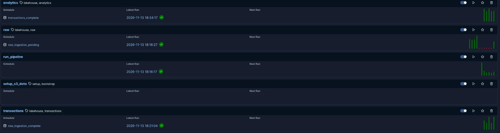
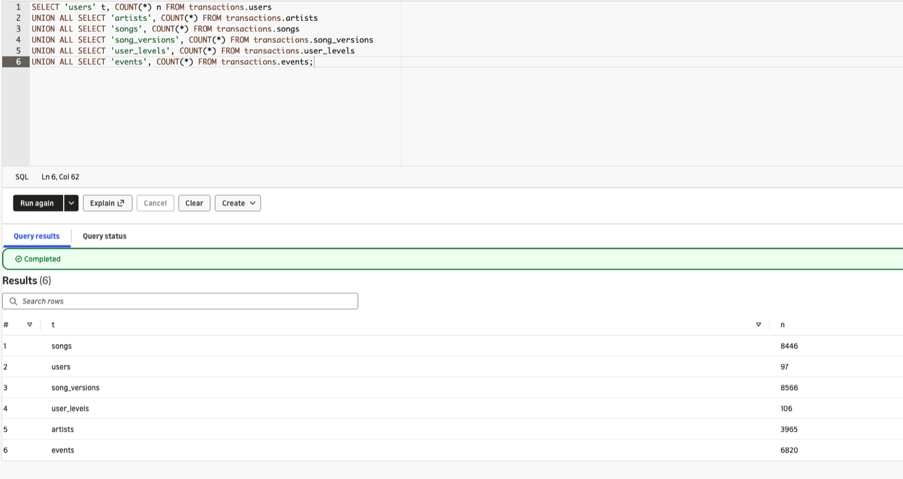

# Sparkify — Event-Driven Iceberg Lakehouse with Apache Airflow

[](https://github.com/adebowalep/sparkify-iceberg-lakehouse-airflow/actions/workflows/tests.yml)


## Project overview
Sparkify is a fictional music-streaming company whose listening logs and song catalogue arrive as raw JSON files in S3. Its old ETL had no lineage, could not be re-run safely, and needed new code for every new source table. This project is a prototype of a replacement: a **medallion lakehouse** (raw → transactions → analytics) on Apache Iceberg tables, with three Apache Airflow 3 DAGs that start each other through **Airflow Assets**. One manual trigger of `run_pipeline` for an interval starts the whole chain.

It began as a Udacity Data Engineering project and was executed successfully in the Udacity AWS workspace. A later correctness review found and fixed three defects and added an automated test suite. **Those fixes have been tested locally and have not yet been re-run on AWS** (see [Testing and verification](#testing-and-verification)). This is an educational project, not a production platform.

## Key results
From the AWS run of the **earlier implementation** (commit `a432963`); counts are taken from the saved Athena exports in [`docs/athena_results/`](docs/athena_results).

| Metric | Recorded result |
|---|---|
| Data intervals processed | 3 (2026-01-01, 2026-01-02, 2026-01-03), each started by one `run_pipeline` trigger |
| Raw log records (`raw.logs`) | 2,618 + 2,592 + 2,560 = **7,770** |
| Transactions tables | **6**: users 97, artists 3,965, songs 8,446, song_versions 8,566, user_levels 106, **events 6,820** |
| Analytics tables | **4**: user_facts 97, session_facts 776, song_facts 8,446, artist_facts 3,965 |
| Source schema evolution | Tested: a new source column was added to the table; older rows stayed `NULL` |
| Re-running an interval | Tested: raw partition and analytics counts were identical after a rerun, with no manual cleanup |
| Failure propagation | Observed: when ingestion failed, validation and the completion event did not run and downstream DAGs did not start |

These results do **not** verify the code changed afterwards (see [Engineering challenges and fixes](#engineering-challenges-and-fixes)); `events` resolution counts and the `song_facts` / `artist_facts` figures may differ after a re-run.

## Architecture


*Airflow's Assets view of the real run: each DAG publishes an Asset when it finishes, and the next DAG is scheduled on that Asset. No cron expressions and no manual triggers between layers.*

```text
Amazon S3: raw JSON files (data_intervals/<interval>/<table>/)
        |
        v
Apache Airflow 3: orchestration only, Asset-triggered DAGs (run_pipeline -> raw -> transactions -> analytics)
        |  starts and monitors
        v
AWS Glue 5.0 / PySpark: the processing engine
        |
        v
Apache Iceberg tables on S3: raw  ->  transactions  ->  analytics
        |
        v
Amazon Athena: SQL validation checks and analytics queries
```

Airflow does not store or transform data. It discovers the work, starts the Glue jobs, runs the Athena checks and emits the Asset events. The data is processed by Spark in Glue and stored as Iceberg tables in S3.

## Technology stack
| Technology | Purpose |
|---|---|
| Apache Airflow 3 | Asset-driven orchestration, dynamic task mapping, task groups |
| AWS Glue 5.0 | Managed Spark jobs (Spark 3.5) |
| PySpark | Data transformation and Iceberg writes |
| Apache Iceberg | Transactional lakehouse tables (partition overwrite, `MERGE INTO`, schema evolution) |
| Amazon S3 | Landing files, Iceberg data and metadata, rendered SQL |
| Amazon Athena | SQL quality checks and analytics queries |
| AWS CloudFormation | Infrastructure definition (bucket, Glue role and databases, Athena workgroup) |
| Pytest | Local regression tests on real SQL and Spark/Iceberg logic |
| GitHub Actions | Continuous integration (local tests only, no AWS access) |

## How the pipeline works
| DAG | Triggered by | What it does | Emits |
|---|---|---|---|
| `run_pipeline` | manual, pick an interval | publishes the interval | `raw_ingestion_pending` |
| **`raw`** | `raw_ingestion_pending` | lists the table folders in S3 (**no table names in code**), starts **one Glue job per table** with dynamic task mapping, writes `iceberg.raw.<table>` partitioned by `data_interval` and **overwrites only that partition**; adds new columns automatically; Athena checks that the interval has rows | `raw_ingestion_complete` |
| **`transactions`** | `raw_ingestion_complete` | renders the SQL templates, uploads them to S3, and a Glue job per table de-duplicates on the key and runs **`MERGE INTO`**, in dependency order (artists → songs → song_versions, users → user_levels, events last); Athena checks primary keys and event resolution | `transactions_complete` |
| **`analytics`** | `transactions_complete` | recomputes four fact tables from `transactions` and **replaces them in full** (`createOrReplace`) | none |

Each Asset event carries `data_interval` and `tables`. A failed ingestion or check stops the chain: the completion event is only emitted after every check passes. Per-layer notes are in `raw/README.md`, `transactions/README.md` and `analytics/README.md`; they are also shown in the Airflow UI through each DAG's `doc_md`.

| Airflow: all DAGs green | Athena: transactions counts |
|---|---|
|  |  |

## Engineering challenges and fixes
| Problem | Cause | Fix | Verified |
|---|---|---|---|
| Dates in the year 50,000+ | Three provided SQL templates read **millisecond** epochs with `from_unixtime()` (seconds) | `CAST(x / 1000 AS TIMESTAMP)`; details in [`docs/sql_corrections.md`](docs/sql_corrections.md) | AWS (Athena date check) and locally |
| Re-running or late-loading an **older interval overwrote newer user data** | Unconditional `MERGE ... UPDATE SET *` | Per-table update rules: `users` updates only if `last_seen_at` is not older; `artists`/`songs` never replace a known value with NULL; deterministic tie-breaks | Locally only |
| A play could be attached to **another artist's song with the same title** | `events.sql` joined on the title and never filtered by artist | A candidate must match title **and** artist name; ties resolve deterministically | Locally only |
| A queued Airflow run could read the **newest asset event overall** instead of its own | `inlet_events[asset][-1]` is the newest event ever; `triggering_asset_events` is scoped to the run | The DAGs read the run's own events and fail with a clear message if one run was started by several intervals | Locally only (from Airflow 3.0.6 source; not observed on AWS) |
| NULL keys and unit errors passed silently | NULL keys never match in a `MERGE`; the checks did not look at timestamps | The Glue job rejects staged data with NULL keys or timestamps in the future | Locally only |

Every defect was first reproduced by a failing test. Decisions, per-table rules and what was not changed are in [`docs/engineering_notes.md`](docs/engineering_notes.md).

## Testing and verification
| Level | Status |
|---|---|
| **Historical AWS run** | The pipeline ran successfully in the Udacity AWS workspace, **before** the correctness fixes (commit `a432963`). Evidence: [`docs/evidence_log.md`](docs/evidence_log.md), [screenshots](docs/screenshots), [Athena exports](docs/athena_results). |
| **Local tests** | `tests/` runs the **real** Glue scripts and SQL templates against synthetic data on local Spark 3.5.4 and Iceberg 1.7.1 (the Glue 5.0 versions), plus Airflow DAG tests. Last full local run: 42 passed, 1 expected failure, 0 failed. |
| **GitHub Actions** | The first run ([run 44545740130](https://github.com/adebowalep/sparkify-iceberg-lakehouse-airflow/actions/runs/44545740130), commit `96206cb`) **failed** at `actions/setup-python`: `cache: pip` was configured without telling it where `requirements-dev.txt` is, so no test step ran. The fix is committed locally and **has not been run on GitHub yet**; no successful run exists. See the [Actions page](https://github.com/adebowalep/sparkify-iceberg-lakehouse-airflow/actions). |
| **Not yet verified** | The correctness fixes on AWS Glue and Athena, and CI on GitHub. |

What the suite covers: replaying older intervals, artist/song resolution, `MERGE` idempotency, source corrections, SQL timestamp conversion, staging-data checks, DAG imports, Asset wiring and interval selection.

**Expected failure.** One test is a strict `xfail`: loading a later interval before an earlier one leaves an extra `initial` row in `user_levels`. It documents a known limitation and is kept so that it flags itself if the behaviour ever changes.

Local runs use a Hadoop Iceberg catalog instead of the Glue Data Catalog and a stubbed `awsglue` module. They do not exercise Athena (Trino) SQL, the Airflow scheduler, IAM or S3.

## How to run the project
**On AWS** (built and run in the Udacity workspace; not intended for a laptop):
1. Deploy `lakehouse_infrastructure.yml` with CloudFormation (needs a VPC and subnet).
2. In Airflow, add the `aws_default` and `athena_default` connections (Athena needs `s3_staging_dir`) and the `s3_bucket` variable (bucket name only).
3. Unpause the DAGs, trigger `setup_s3_data`, then trigger `run_pipeline` for one interval (`2026-01-01`, `2026-01-02` or `2026-01-03`) and wait for it to finish before starting the next.
4. Query the `raw`, `transactions` and `analytics` databases in Athena.

Never commit AWS credentials; temporary session tokens expire and must be refreshed in the Airflow connections.

**Local tests** (no AWS account; Python 3.11 and Java 11 or 17):
```bash
python3.11 -m venv .venv && source .venv/bin/activate
curl -sL https://raw.githubusercontent.com/apache/airflow/constraints-3.0.6/constraints-3.11.txt | grep -viE '^(pyspark|py4j)==' > /tmp/constraints.txt
pip install -r requirements-dev.txt -c /tmp/constraints.txt "jdk4py>=17,<18"   # jdk4py only if you have no Java
pytest tests/test_orchestration.py     # seconds
pytest tests                           # about 12 minutes: each pipeline load runs several Spark jobs
```

## Known limitations
- **Insert/update only.** Corrected and new source records are applied, but records *removed* from a corrected interval are not deleted from `transactions` (tested and documented; a safe delete would need a `source_interval` column).
- **Out-of-order first loads.** `user_levels` derives its `initial` row from the raw intervals loaded so far, so loading a later interval first leaves an extra `initial` row. Current levels are unaffected.
- **Events resolve against the catalogue loaded so far.** A play whose song appears in a later interval stays unresolved until its interval is replayed; the existing check tolerates fewer than 30% unresolved `version_id`.
- **One interval per run.** Trigger `run_pipeline` once per interval and wait for it to finish.
- **Local tests differ from AWS** (catalog, Athena, scheduler, IAM), and the fixes after commit `a432963` have not run on AWS.

## Repository structure
```text
setup/                       setup_s3_data and run_pipeline DAGs
raw/                         DAG, Glue script, README
transactions/                DAG, Glue script, sql/*.sql, README
analytics/                   DAG, Glue script, sql/*.sql, README
tests/                       pytest suite: local Spark/Iceberg pipeline tests and Airflow DAG tests
.github/workflows/tests.yml  CI (local tests only; no AWS access)
lakehouse_infrastructure.yml CloudFormation template
docs/                        evidence log, engineering notes, SQL corrections, Athena exports, screenshots
VERIFICATION_REPORT.md       requirement-by-requirement verification
requirements-dev.txt         test dependencies
```

## Documentation and evidence
- [`docs/engineering_notes.md`](docs/engineering_notes.md): findings, per-table update rules, decisions, licensing notes
- [`docs/evidence_log.md`](docs/evidence_log.md): AWS execution evidence (Airflow runs and Athena results)
- [`docs/sql_corrections.md`](docs/sql_corrections.md): the millisecond-timestamp bug and later SQL changes
- [`VERIFICATION_REPORT.md`](VERIFICATION_REPORT.md): what was verified where
- [`docs/screenshots/`](docs/screenshots) and [`docs/athena_results/`](docs/athena_results): the historical AWS evidence, captured before the correctness fixes

## Credits and licensing
Built as a project in the Udacity Data Engineering program. The project brief, starter code, SQL templates, CloudFormation template and the `setup/` DAGs were provided by Udacity; the DAGs, Glue scripts, validation checks, fixes, tests and documentation for the raw, transactions and analytics layers are my implementation.

[`LICENSE.txt`](LICENSE.txt) is Udacity's licence for its educational content (Creative Commons BY-NC-ND 4.0 for material marked as such, with further restrictions). Several files here derive from Udacity-provided starter material, and **whether they may be redistributed publicly has not been established** (see [`docs/engineering_notes.md`](docs/engineering_notes.md), section 8). The course datasets are not included. If in doubt, ask Udacity before relying on this repository being public.
