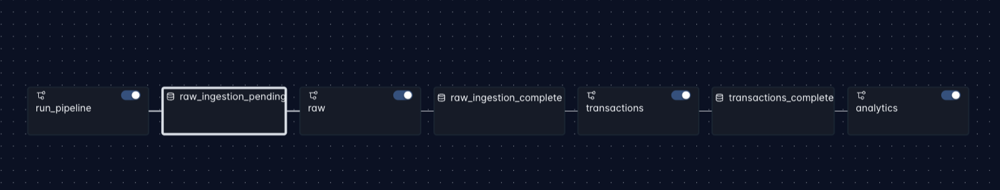

# Sparkify Iceberg Lakehouse with Apache Airflow

An **event-driven data lakehouse on AWS** for a music-streaming company (Sparkify). Three Airflow 3 DAGs, chained through **Airflow Assets**, move raw JSON logs through a **medallion architecture** (raw → transactions → analytics) built on **Apache Iceberg** tables, **AWS Glue 5.0 (PySpark)** and **Amazon Athena**.

One manual trigger of `run_pipeline` is all it takes: everything downstream starts by itself.



## Why this project
Sparkify's legacy ETL had three problems: no **lineage**, non-**reproducible** reruns, and one-off scripts that are hard to **maintain**. This prototype answers each one:

| Problem | How it is solved |
|---|---|
| Lineage | Airflow Assets make every dependency explicit (`raw_ingestion_pending` → `raw_ingestion_complete` → `transactions_complete`); asset events carry the `data_interval` and the `tables` processed. |
| Reproducibility | Raw overwrites only the partition of the interval being loaded; transactions upsert with `MERGE INTO`; analytics are full snapshots. Re-running an interval gives identical counts. |
| Maintainability | Raw ingestion discovers source tables by listing S3, so a new source folder needs **no code change** (verified, see below). |

## Architecture

```
run_pipeline (manual, pick interval)
   │  emits Asset: raw_ingestion_pending {data_interval}
   ▼
raw ──► discover tables in S3 ► one Glue job per table (dynamic task mapping)
   │    ► Iceberg raw.<table> partitioned by data_interval ► Athena checks
   │  emits Asset: raw_ingestion_complete {data_interval, tables}
   ▼
transactions ──► render SQL (Jinja) ► upload to S3 ► Glue job: dedup + MERGE INTO
   │    users, artists → songs → song_versions · users → user_levels · events last
   │    ► Athena checks (primary keys, version resolution)
   │  emits Asset: transactions_complete {data_interval, tables}
   ▼
analytics ──► render SQL ► Glue job ► createOrReplace (full snapshot)
              user_facts · session_facts · song_facts · artist_facts
```

**Stack:** Apache Airflow 3 (Assets, dynamic task mapping, TaskGroups, `doc_md`), AWS Glue 5.0 / PySpark, Apache Iceberg (Parquet + Snappy), Amazon S3, Amazon Athena, AWS CloudFormation.

## The three layers

### Raw (`raw/`)
- `capture_landing_keys` lists the table folders under `data_intervals/<interval>/` with `S3Hook`; `GlueJobOperator.partial(...).expand_kwargs(...)` runs one Glue job per discovered table.
- The Glue job creates `iceberg.raw.<table>` on first run, then uses `overwritePartitions()` so only the loaded interval is replaced. New columns are added automatically (schema evolution).
- Athena `SQLCheckOperator`s confirm the interval has rows in `raw.logs` and `raw.songs`.

### Transactions (`transactions/`)
- Six normalised tables: `users`, `artists`, `songs`, `song_versions`, `user_levels`, `events` (partitioned by `event_date`).
- Each table's SQL is rendered with the Airflow context, uploaded to S3, and executed by a Glue job that de-duplicates on the primary key and runs `MERGE INTO` (update matches, insert new rows).
- Promotion order follows the dependencies; the `validate_transactions` group checks primary-key uniqueness for all six tables and that fewer than 30% of events have an unresolved `version_id`. The completion event is only emitted if every check passes.

### Analytics (`analytics/`)
- Four fact tables recomputed from `transactions` on every run and replaced in full (`createOrReplace`), so they always mirror the current transactional state. No append or insert.

## Results (real Athena output from the Airflow/Glue run)

> These numbers, screenshots and Athena exports come from the implementation at commit `a432963`, executed on AWS. Later commits (see *Correctness review* below) changed the transactions logic and were verified **locally only**; they have not been re-run on AWS, so the recorded `events`/analytics numbers may differ after a re-run.

| Layer | Table | Rows |
|---|---|---|
| raw | `logs` (2026-01-01 / 01-02 / 01-03) | 2618 / 2592 / 2560 |
| transactions | users · artists · songs | 97 · 3965 · 8446 |
| transactions | song_versions · user_levels · events | 8566 · 106 · 6820 |
| analytics | user_facts · session_facts | 97 · 776 |
| analytics | song_facts · artist_facts | 8446 · 3965 |

What was verified end to end:
- **Event-driven execution:** each of the three intervals triggers `raw` → `transactions` → `analytics` automatically; every downstream run is `asset_triggered`.
- **Reproducibility:** re-running `2026-01-01` left the raw partition (2618) and every analytics count unchanged.
- **New source folder with no code change:** a temporary `zz_schema_test/` folder was picked up (a third mapped Glue job, a new `raw` table) and then removed.
- **Schema evolution:** a later file with an extra column added it to the table; older rows stayed `NULL`.
- **Failure handling:** when AWS credentials expired, the failed ingestion left `validate_raw` and `notify_complete` as `upstream_failed`, no completion event was emitted, and downstream DAGs did not start.

| Airflow: all DAGs green | Athena: transactions counts |
|---|---|
|  |  |

More evidence: [`VERIFICATION_REPORT.md`](VERIFICATION_REPORT.md), [`docs/evidence_log.md`](docs/evidence_log.md), [`docs/screenshots/`](docs/screenshots), Athena result CSVs in [`docs/athena_results/`](docs/athena_results).

## A bug found and fixed in the provided SQL
`logs.ts` and `registration` are Unix **milliseconds**, but three provided templates passed them to `from_unixtime()` (seconds). Result: `event_date`, `registration` and `changed_at` landed in the year 50,000+ and were stored as strings. The fix (`CAST(x / 1000 AS TIMESTAMP)`) is minimal and documented in [`docs/sql_corrections.md`](docs/sql_corrections.md); row counts did not change and dates are now 2018-10 to 2018-11.

## Correctness review (after the AWS run)
A later review found and fixed three defects, each reproduced by a failing test first (details and decisions in [`docs/engineering_notes.md`](docs/engineering_notes.md)):

| Defect | Fix |
|---|---|
| Re-running or late-loading an **older interval overwrote newer user state** (unconditional `MERGE ... UPDATE SET *`) | Per-table update rules: `users` only updates when the incoming `last_seen_at` is not older; `artists`/`songs` never replace a known value with NULL; deterministic tie-breaks |
| A play could be attached to **another artist's song with the same title** | `events.sql` now requires title **and** artist name to match; ties resolve deterministically |
| An Airflow run could read the **newest asset event overall** instead of the one that triggered it (queued runs) | Interval is taken from the run's own `triggering_asset_events`; runs triggered by several intervals fail with a clear message |

Also added: Glue-side checks that reject NULL keys and timestamps in the future (the signature of the earlier milliseconds bug).

## Testing
`tests/` runs the **real** Glue scripts and SQL templates against synthetic data on local Spark 3.5.4 + Iceberg 1.7.1 (the Glue 5.0 versions), plus Airflow DAG tests. No AWS account is needed.

```bash
python3.11 -m venv .venv && source .venv/bin/activate
curl -sL https://raw.githubusercontent.com/apache/airflow/constraints-3.0.6/constraints-3.11.txt | grep -viE '^(pyspark|py4j)==' > /tmp/constraints.txt
pip install -r requirements-dev.txt -c /tmp/constraints.txt "jdk4py>=17,<18"   # jdk4py only if you have no Java 11/17
pytest tests/test_orchestration.py     # seconds
pytest tests                           # about 20 minutes (each pipeline load runs several Spark jobs)
```

| Verified where | Status |
|---|---|
| AWS (Udacity workspace) | original implementation, commit `a432963` (evidence below) |
| Locally with pytest | all tests in `tests/` pass (see `docs/engineering_notes.md` for the exact scope) |
| GitHub Actions | workflow in `.github/workflows/tests.yml`; **no run recorded yet** |
| AWS, after the correctness fixes | **not yet** |

Local runs use a Hadoop Iceberg catalog instead of the Glue Data Catalog and fake the `awsglue` module; Athena SQL and the Airflow scheduler are not exercised.

## Known limitations
- **Insert/update only transactions layer.** Corrected and new source records are applied; records *removed* from a corrected interval are not deleted from `transactions` (tested and documented; a safe delete would need a `source_interval` column).
- **Out-of-order first loads.** `user_levels` derives its `initial` row from the raw intervals loaded so far, so loading a later interval before an earlier one leaves an extra `initial` row (current levels are unaffected).
- **Events resolve against the catalog loaded so far.** A play whose song appears in a later interval stays unresolved until its interval is replayed; the existing check tolerates fewer than 30% unresolved `version_id`.
- **One interval per run.** Trigger `run_pipeline` once per interval and wait for it to finish.

## Repository layout
```
setup/                  setup_s3_data (seed landing data) and run_pipeline (manual trigger)
raw/                    dag.py, glue_script.py, README.md
transactions/           dag.py, glue_script.py, sql/*.sql, README.md
analytics/              dag.py, glue_script.py, sql/*.sql, README.md
lakehouse_infrastructure.yml   CloudFormation: S3 bucket, Glue role + databases, Athena workgroup
tests/                  pytest suite: local Spark/Iceberg pipeline tests + Airflow DAG tests
.github/workflows/      CI (local tests only; no AWS access)
docs/                   evidence log, engineering notes, Athena results, screenshots, SQL correction notes
VERIFICATION_REPORT.md  requirement-by-requirement verification
```
Each DAG has its own README rendered in the Airflow UI through the DAG's `doc_md`.

## Running it
This project depends on AWS resources and a preconfigured Airflow, and was built and run in the **Udacity Workspace**; it is not meant to run on a laptop.

1. Deploy `lakehouse_infrastructure.yml` with CloudFormation (needs a VPC and subnet).
2. In Airflow, add the `aws_default` and `athena_default` connections (the Athena one needs `s3_staging_dir`) and the `s3_bucket` variable (bucket name only).
3. Unpause the DAGs, trigger `setup_s3_data`, then trigger `run_pipeline` with an interval (`2026-01-01`, `2026-01-02` or `2026-01-03`).
4. Query the `raw`, `transactions` and `analytics` databases in Athena.

Never commit AWS credentials; temporary session tokens expire and must be refreshed in the Airflow connections.

## Credits
Built as a project in the Udacity Data Engineering program. The project brief, starter code, SQL templates, CloudFormation template and the `setup/` DAGs were provided by Udacity; the Airflow DAGs, Glue scripts, validation checks, fixes and documentation for the raw, transactions and analytics layers are my implementation.

## Licensing
[`LICENSE.txt`](LICENSE.txt) is Udacity's licence for its educational content (Creative Commons BY-NC-ND 4.0 for material marked as such, with further restrictions). Several files here derive from Udacity-provided starter material, and this repository contains completed versions of them. **Whether they may be redistributed publicly has not been established** (see `docs/engineering_notes.md`, section 8). Course datasets are not included. If in doubt, keep the repository private or ask Udacity before publishing.
